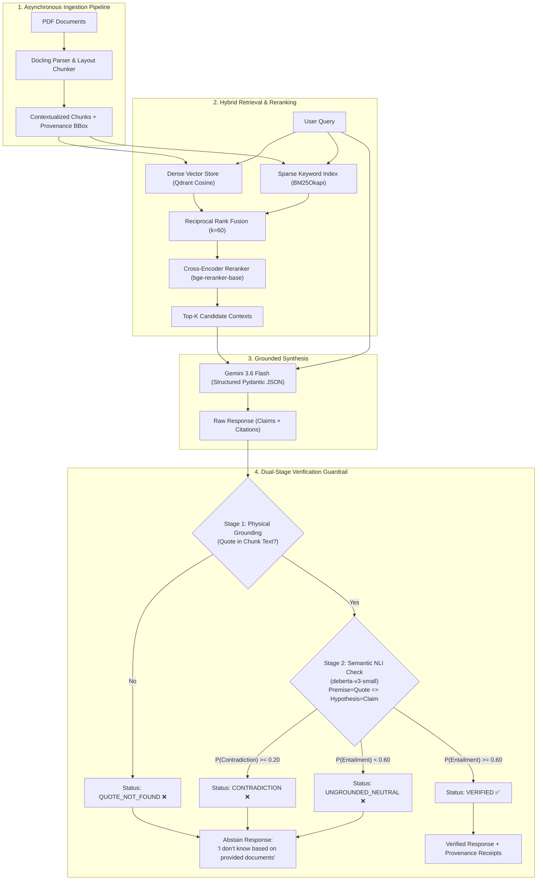

# Enterprise Verifiable RAG

> **Zero-hallucination document intelligence engine powered by Hybrid Search (Dense + BM25 + Cross-Encoder Reranking) and Dual-Stage Semantic NLI Citation Verification.**

[](https://www.python.org/downloads/)
[](https://fastapi.tiangolo.com)
[](https://qdrant.tech/)
[](https://opensource.org/licenses/MIT)

---

## 🏛️ System Architecture



---

## 🌟 Key Engineering Innovations

### 1. Dual-Stage Verification Guardrail (Eliminating Hallucinations)
Most RAG systems rely on "prompt engineering" or naive regex string matching to verify citations. This system implements a **two-phase mathematical verification engine**:
* **Stage 1 (Physical Grounding):** Ensures the citation quote actually exists within the specific retrieved document chunk, accounting for OCR hyphenation and whitespace normalization. If a model fabricates a quote, it is rejected immediately (`QUOTE_NOT_FOUND`).
* **Stage 2 (Natural Language Inference Entailment):** Evaluates the logical entailment between the cited quote (Premise) and the generated claim (Hypothesis) using `cross-encoder/nli-deberta-v3-small`.
  * **Strict Decision Boundary:**
    $$\text{Accept iff } P(\text{Entailment}) \ge 0.60 \quad \land \quad P(\text{Contradiction}) < 0.20$$
  * Any ungrounded or speculative statements fall into the **Neutral** distribution ($P(\text{Neutral}) \approx 0.95+$) and are **strictly quarantined**, preventing hallucination pass-through.

### 2. Hybrid Search with Reciprocal Rank Fusion & Reranking
* **Dense Search:** Embedding vectors generated via `BAAI/bge-small-en-v1.5` indexed in Qdrant (supports both persistent networked clusters and isolated in-memory instances).
* **Sparse Search:** Exact keyword tokenization via BM25Okapi for technical identifiers, rules, and numeric codes.
* **Fusion & Reranking:** Results are merged using Reciprocal Rank Fusion ($k=60$), followed by a `BAAI/bge-reranker-base` cross-encoder pass to output the most contextually relevant chunks.

### 3. Production Microservice Architecture
* **Tenant Isolation:** Uploads and indexes are partitioned by `session_id`, preventing data cross-contamination or global file overwrites.
* **Thread-Safe Model Caching:** Heavy transformer models (`SentenceTransformer`, `CrossEncoder`) are loaded once into a thread-safe singleton cache, eliminating redundant memory allocation across concurrent sessions.
* **Non-Blocking Background Tasks:** Document parsing and embedding generation run asynchronously with real-time job status tracking (`QUEUED`, `PROCESSING`, `INDEXING`, `COMPLETED`, `FAILED`).

---

## 📊 Automated Evaluation Suite

The system includes an automated evaluation harness (`RAGEvaluator` in `src/evaluator.py`) benchmarked against adversarial, multi-hop, and in-domain test cases (`data/evaluation_benchmark.json`):

* **Hallucination Blocking Rate (Adversarial):** Measures accuracy in rejecting out-of-domain and ungrounded queries.
* **In-Domain Verification Rate:** Percentage of valid queries answered with certified citations.
* **NLI Faithfulness Entailment:** Average mathematical entailment confidence across all claims.
* **Context Recall:** Coverage of ground-truth concepts in retrieved contexts.
* **Latency Profiling:** P50, P90, and P99 latency percentiles.

Run the benchmark:
```bash
python run_evaluation.py
```

---

## 🚀 Quickstart

### Prerequisites
* Python 3.12+
* Google Gemini API Key (`GEMINI_API_KEY`)

### Option A: Local Development

1. **Clone & Setup Environment:**
   ```bash
   git clone https://github.com/your-username/verifiable-rag.git
   cd verifiable-rag
   python -m venv venv
   source venv/bin/activate  # On Windows: .\venv\Scripts\activate
   pip install -r requirements.txt
   ```

2. **Configure Environment:**
   Create a `.env` file in the root directory:
   ```env
   GEMINI_API_KEY=your_gemini_api_key_here
   ```

3. **Run Unit & Verification Tests:**
   ```bash
   pytest tests/
   ```

4. **Start the API Server:**
   ```bash
   python api.py
   # Runs on http://localhost:8000 (Swagger docs at http://localhost:8000/docs)
   ```

5. **Start the Streamlit Client:**
   ```bash
   streamlit run app.py
   # Opens UI on http://localhost:8501
   ```

### Option B: Docker Compose Deployment

```bash
docker-compose up --build
```
This spins up:
* **Qdrant Vector Database:** `http://localhost:6333`
* **Enterprise FastAPI Backend:** `http://localhost:8000`
* **Streamlit Web UI:** `http://localhost:8501`

---

## 📡 API Reference

| Method | Endpoint | Description |
| :--- | :--- | :--- |
| `POST` | `/api/v1/upload` | Upload PDF and dispatch asynchronous indexing task (`session_id` scoped). |
| `GET` | `/api/v1/jobs/{job_id}` | Poll background indexing job status, progress, and diagnostics. |
| `POST` | `/api/v1/chat` | Query the hybrid index and receive verified answers with receipts. |
| `GET` | `/api/v1/health` | Healthcheck and active session statistics. |

---

## 🧪 Test Suite

Run the full pytest suite:
```bash
pytest tests/ -v
```
Tests cover:
* Schema serialization and validation (`test_schemas.py`)
* Dense/Sparse hybrid retrieval and empty corpus handling (`test_retriever.py`)
* Dual-stage verification guardrails: valid entailment, quote-not-found rejection, contradiction blocking, and neutral hallucination rejection (`test_generator.py`).
